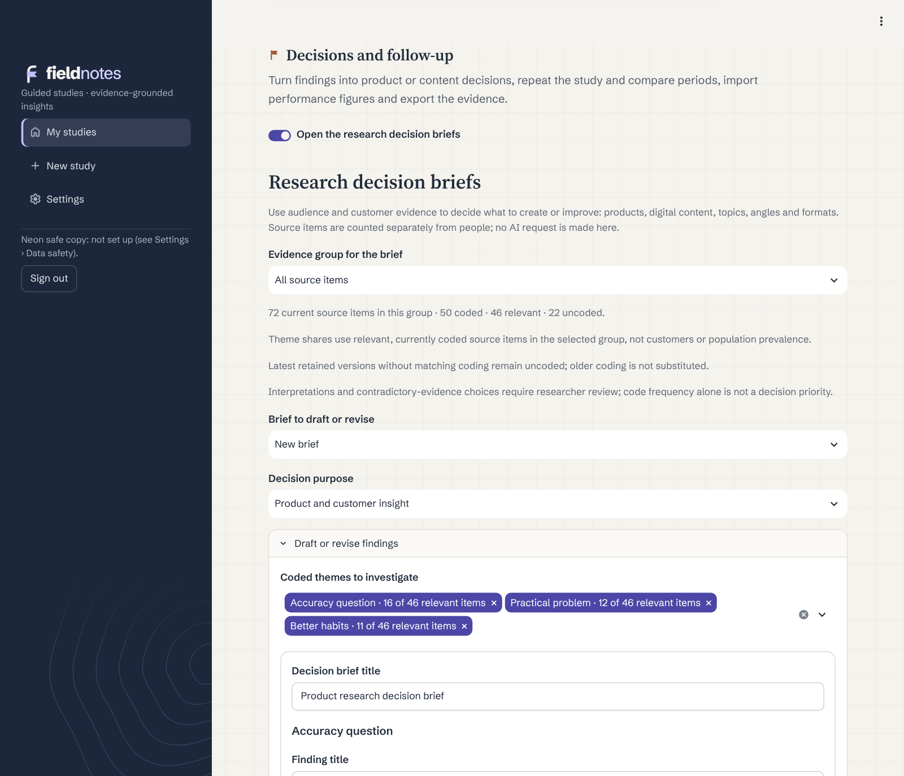
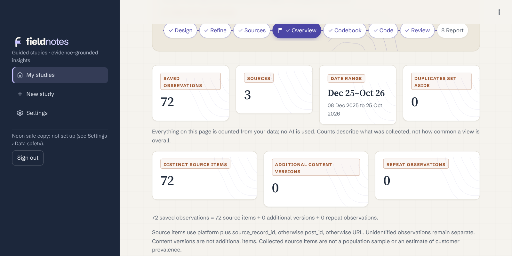

<picture>
  <source media="(prefers-color-scheme: dark)" srcset="images/logo-reversed.png">
  
</picture>

**An AI research assistant for social listening.** Ask what people are saying about a topic. Fieldnotes
helps you design the study, finds and saves the conversation, codes every post with AI, and writes a
research summary with content recommendations. It can then keep watching the question for new posts.

> **[Try the demo → fieldnotes.streamlit.app](https://fieldnotes.streamlit.app)**. The demo uses made-up posts,
> and live searches and AI are switched off. If it has been asleep, press the wake-up button and give it
> about a minute. The source code is private.

<picture>
  <source media="(prefers-color-scheme: dark)" srcset="images/dark/home.png">
  
</picture>

Fieldnotes looks like a field survey: a faint survey grid, contour lines, a route for the study's eight steps with a
flag on the current one, and quotations on ruled notebook paper. It comes in a light and a dark version and follows
your device's setting, and so do the screenshots on this page.

## What it does

| Step | What happens |
| --- | --- |
| **Design** | Type a rough question. AI drafts a research design: a precise question, the decision it informs, whose conversations count, the period, places and languages, and the kind of study. You check it and approve it. |
| **Refine** | AI suggests sharper research questions and search terms within the design; you approve them. |
| **Sources** | Search YouTube, Bluesky, X, the web, Reddit and Substack together, collect from RSS and Atom feeds, Hacker News, Stack Exchange and Instagram, or import exports from listening tools such as Brandwatch, Talkwalker, Meltwater and Sprout Social. |
| **Overview** | A free first look: volume over time, platforms, most-used words, example posts, and whether the data fits your design. It also shows what is being counted: saved observations, distinct source items, extra versions of edited items and repeat observations. |
| **Codebook** | AI drafts a codebook (themes, sentiment, relevance) that follows the design; you check and approve it. |
| **Code** | Every post is coded by AI against the approved codebook, with a cost estimate first and live progress. |
| **Review** | Check the posts the AI was unsure about, plus a spot check, one at a time. |
| **Report** | A research summary with findings, what it means for your decision, audience needs and content ideas, downloadable as Word, PDF or Markdown. Below it, reviewable decision briefs, repeat studies, performance figures and an evidence export, closed until you open them. |

## Where Fieldnotes fits

**Fieldnotes is for question-led research with an evidence trail you can review.** You start with a research
question and a design, collect from sources you're entitled to use, code with a codebook you approve, check what
the AI wasn't sure about, and finish with findings linked to the posts, the coding and the study version behind
them. It's aimed at an analyst, researcher or content strategist running focused studies.

It doesn't claim to be the best or the only tool of its kind. What it offers is the whole path in one inspectable
workflow, without a data licence.

### What it's built to do well

- **Design first, and it holds you to it.** A saved research design drives the search, the codebook, the coding
  and the report. In testing, saving a preview after the design had changed was refused as stale, and changing the
  design after coding was flagged on every later step.
- **Numbers counted, quotations checked.** The app counts every figure from the coded data. The AI only writes
  prose, and any figure it states that the data doesn't support is flagged. Every quotation is checked word-for-word
  against its post.
- **Source data stays faithful.** In tests with feeds, an unknown publication date stayed unknown instead of being
  invented, literal text such as `<draft>` was kept intact, and both versions of a revised item were retained.
- **One codebook, applied the same way to every post.** Coding follows an approved, versioned codebook. Each
  answer is checked against its structure, repaired once if invalid, and reported as failed if it still isn't.
  Each run is pinned to the exact dataset and codebook version it used.
- **People in the loop, with an audit trail.** Uncertain posts and a random spot check go to a person. Decisions
  are kept as new records, the AI's original is never overwritten, and reports use the reviewed version.
- **Reliability tools included.** Compare the AI with a hand-coded reference set (precision, recall, F1), or compare
  two to ten human coders (Cohen's or Fleiss' kappa).
- **Honest reports.** They state what the sample is and isn't, what each source can and can't filter, and how
  much a person checked.
- **Costs and consent up front.** You see a cost estimate before coding, and nothing goes to an AI service until
  you allow it.
- **Honest counting.** A post isn't a person. Overview separates saved observations from distinct source items,
  edited versions and repeat observations, and says what it can't tell (it never guesses identity from similar
  wording or author names).
- **Findings that become reviewed decisions.** A decision brief pins each finding to its supporting and contrary
  posts, and records the uncertainty and the next thing to investigate. If the evidence later changes, the brief is
  marked as needing review rather than quietly rewritten.
- **It keeps watching and repeats the study.** Scheduled checks add only new posts, code them with the same codebook
  and show what changed. Repeat studies compare periods only when the comparison is fair, and say when it isn't.
- **Your data stays yours.** It lives in your own database, with a compressed safe copy and downloadable backups.
  Codebooks export as JSON.

### Data without an enterprise data licence

Fieldnotes works from sources you're already entitled to use: the official YouTube Data API, Bluesky's API, Brave
Search, public RSS and Atom feeds, Hacker News, Stack Exchange and your own exports from listening tools. Reddit is
reached only through search-result snippets, and public-feed collection is planned and approved before it runs.
No scraping.

"No licence fee" isn't the same as "no terms": each source's own rules still apply, and hosting, storage and AI
costs are separate.

## Start with a research design

Fieldnotes turns a rough question into a study you can defend. It marks what it assumed so you can check it,
asks a few quick questions to sharpen the draft, and saves your work as you go. Choose from four kinds of
study: **exploratory**, **descriptive**, **comparative** (two or more groups, side by side) and
**longitudinal** (change over time). Research templates and advanced designs are there when you need them.
Searching, coding and the report all follow the approved design, and if the design changes after coding,
every later step says so.

<picture>
  <source media="(prefers-color-scheme: dark)" srcset="images/dark/design.png">
  
</picture>

<picture>
  <source media="(prefers-color-scheme: dark)" srcset="images/dark/phone-design.png">
  
</picture>

## More places to listen

One guided search covers several sources at once: YouTube, Bluesky, X (through xAI's X Search, which returns
cited excerpts), the web, and Reddit and Substack (through Brave Search, as links and snippets). Fieldnotes can also
collect from public RSS and Atom feeds, Hacker News and Stack Exchange, and from Instagram hashtags and
professional accounts through Meta's official API once Meta has approved the app. It suggests feeds that match
your research question, picks the Stack Exchange site that fits your topic (Psychology & Neuroscience, Philosophy,
Parenting and others), and can suggest Instagram hashtags with AI and check with Meta that each one is active
before it is searched. The sources run at the same time, and a large X search is split into smaller requests, so a
search takes about as long as its slowest source. Every collection is planned and approved first, and each source
states exactly what it can and can't filter, so nothing is implied that didn't happen.

<picture>
  <source media="(prefers-color-scheme: dark)" srcset="images/dark/sources.png">
  
</picture>

## See the data before you spend anything

<picture>
  <source media="(prefers-color-scheme: dark)" srcset="images/dark/overview.png">
  
</picture>

## A research summary built on checked evidence

The app calculates every figure and picks every quotation from the coded data itself. The AI writes only
the prose: the headline, findings, what this means for your decision, what the audience wants to know and
what content to make. Any figure the AI states that the data doesn't back up is flagged.

<picture>
  <source media="(prefers-color-scheme: dark)" srcset="images/dark/report-summary.png">
  
</picture>

Comparative studies show each group side by side, including posts that belong to more than one group.

<picture>
  <source media="(prefers-color-scheme: dark)" srcset="images/dark/content-ideas.png">
  
</picture>

Longitudinal studies chart how often each theme comes up, month by month.

<picture>
  <source media="(prefers-color-scheme: dark)" srcset="images/dark/change-over-time.png">
  
</picture>

## From findings to decisions

Under the summary, a **Decisions and follow-up** section turns findings into something you can act on and
revisit. It stays closed until you open it, and opens by itself once the study has a brief.

<picture>
  <source media="(prefers-color-scheme: dark)" srcset="images/dark/decisions.png">
  
</picture>

**Decision briefs.** Choose all your posts or one comparison group, pick the coded themes to investigate, then
write each interpretation and what it means for the decision. For every finding you select supporting and
contrary posts, say what you checked for counter-evidence, state the uncertainty and note what to investigate
next. Quotations must appear word for word in the retained post. A brief is drafted first and only marked
**Reviewed** after you confirm it. The brief can be for a product decision or a piece of digital content, with
fields for audience, angle, format, channel and a plan for testing the idea. Every edit adds a revision, and if
the study's evidence changes afterwards, the brief says it needs review.

**Repeat the study.** Run the same study again on a schedule from sources you've already approved, or add manual
period checkpoints for imported feedback. Nothing is collected until you switch it on. Fieldnotes then compares
periods only when the comparison is fair, so it withholds one when the scope, codebook or collection changed, the
periods overlap, coding is incomplete or collection was limited or failed.

**Performance figures.** Import content-performance numbers you've exported (a simple CSV template with each
metric's definition, unit and period), and link them to a decision. Each import is saved as its own snapshot and
never summed with another, and no analytics account is contacted.

**Opportunities.** A board compares findings across reviewed briefs. You set the priority, 1 to 5, with a reason.
Frequency never sets it for you.

**Narrative leads.** A local, rules-based grouping of similar vocabulary suggests possible narratives for you to
review. You can download the ones you confirm as candidate codes and import them into the codebook, where you
still approve them. It groups words, not meaning, so it can join opposing views.

**Export the evidence.** Download a brief or a full evidence package: the source posts with their provenance, the
brief and its revisions, codebooks, decisions, outcomes and period snapshots, with a checksum manifest. You can
also record a decision, its owner, a next-check date and what you later observed. These are your judgements, not
measurements of causal impact.

<picture>
  <source media="(prefers-color-scheme: dark)" srcset="images/dark/counting.png">
  
</picture>

These parts use no AI request of their own. They have been tested only on made-up data, and the opportunity
board and narrative grouping haven't been validated on real studies.

## Keeps watching the question

Turn on watching and Fieldnotes checks your sources on a schedule. Each check saves only posts that are
new to the study, codes them with the approved codebook, and shows what changed. Nothing runs, and nothing
is spent, until you allow it.

<picture>
  <source media="(prefers-color-scheme: dark)" srcset="images/dark/watching.png">
  
</picture>

## People stay in charge

The AI's codes are checked where it was unsure, and every check is recorded. The report says exactly how
much was reviewed by a person.

<picture>
  <source media="(prefers-color-scheme: dark)" srcset="images/dark/review.png">
  
</picture>

## Codebooks and coding

A codebook is the rulebook for coding: which themes exist, what each one means, and how a post qualifies.
Fieldnotes treats it as a research instrument. It's versioned and approved before use, and every coding run
records exactly which version it followed.

### How a codebook is structured

| Part | What it holds |
| --- | --- |
| **Dimensions** | The questions asked of every post, such as *Is it relevant?*, *What's the sentiment?* or *What topics does it raise?* Each is either single-choice or multiple-choice, can be required or optional, and can demand a supporting quotation from the post for every code chosen. |
| **Codes** | The possible answers. Each has a label, a definition, inclusion and exclusion criteria, worked examples, and a flag that sends uncertain cases to a person. Codes can be nested under parent codes, carry a researcher's memo and have a display colour. |
| **Relevance gate** | One dimension decides whether a post counts at all: relevant, not relevant or unclear. Every gate code must be classified, and unclear posts go to a person. Only relevant posts feed the figures. |
| **Analysis roles** | Which dimension holds sentiment, for example, so the charts use it. Roles are declared, never guessed from names. |
| **Guidance and examples** | Instructions the coder must follow, such as "do not infer age or gender", and up to 20 fully coded example posts. |
| **Signals and review triggers** | Yes/no flags the coder must report, such as "shares private information", and rules that send matching posts to human review. |

Codebooks follow a published, versioned format (schema 1.0 and 1.1) with a downloadable JSON Schema. They can
be imported and exported as JSON, so a framework can be reused across studies.

### How a codebook is generated

- **Drafted from your study.** AI reads your research questions, your approved research design and up to 50 of
  the study's own posts, then proposes topics inside a fixed, always-valid structure:
  - a relevance gate written from the design's population and inclusion rules;
  - a sentiment dimension;
  - one to three topic dimensions, each requiring a supporting quotation.
- **Works without AI too.** Without an AI key, a sound starter codebook is used instead, and you can edit it.
- **Nothing is used until you approve it.** Drafts are stored inactive. Editing a code's label, definition,
  criteria, examples, parent, memo or colour creates a new version, and the approved original never changes.
- **Restructure safely.** Merge or split codes into a new version. Earlier versions, their coding, reviews and
  reports stay exactly as they were.

### How posts are coded and checked

1. **Cost first.** You see an estimate and confirm before any post is sent to the AI.
2. **Runs on the server.** Coding carries on if you close the page or sign out, up to 16 posts at a time, and
   pauses and resends if OpenAI asks it to slow down. Each coded post is saved as it goes, so a run that is
   interrupted can be resumed, and "not yet coded" sends only the posts no earlier run has coded.
3. **Structured answers.** Each post is coded against the approved codebook, with a supporting quotation wherever
   the codebook requires one, a confidence rating and the declared signals. Answers that break the codebook's structure are repaired once or
   reported as failed.
4. **Review routing.** Low-confidence answers, unclear relevance, possible sarcasm and any review trigger send a
   post to a person, together with a random spot check.
5. **Human review.** You accept, correct or add codes one post at a time. Each decision is a new record, the AI's
   original is kept, and reports use the human-reviewed version wherever it exists.
6. **Reliability, when you need it:**
   - compare the AI with a locked, hand-coded reference set (precision, recall, F1 and relevance accuracy);
   - give the same posts to two to ten coders and measure agreement (Cohen's or Fleiss' kappa).
7. **Deeper analysis.** In the analysis workspace you can:
   - code exact passages, with AI passage suggestions you can accept or reject;
   - see which themes tend to appear together;
   - build themes with the evidence for and against them;
   - use a framework matrix that summarises each code's evidence.

## Tools for detailed analysis

For deeper qualitative work, an optional analysis workspace adds passage coding, themes with the evidence
for and against them, a framework matrix, a hypotheses notebook, research cases and team coding with
agreement scores. Each keeps its own review steps and audit trail.

<picture>
  <source media="(prefers-color-scheme: dark)" srcset="images/dark/workspace.png">
  
</picture>

## Settings and advanced tools

Fieldnotes starts in a simple guided view: eight steps, one study at a time, nothing to configure. Everything
more specialised sits behind a switch in **Settings**, off until you turn it on, so a first-time user never sees
it and an experienced researcher can have all of it. Settings are saved in the research database, so they travel
with backups and the safe copy. In the demo they're shown but locked.

<picture>
  <source media="(prefers-color-scheme: dark)" srcset="images/dark/settings.png">
  
</picture>

### What the main screens show

| Switch | What it does | Why it's there |
| --- | --- | --- |
| **Advanced tools in the sidebar** | Adds the full research workbench: project overview, research planning, collection, analysis handoff, uploads, data quality, codebooks, coding, gold sets, evaluation, human review, trends, insights, reports and backups. | The guided steps cover a typical study. The workbench is for work they don't cover, such as checking AI coding against a hand-coded gold set, editing a codebook in detail or inspecting data quality. |
| **Active dataset and codebook selector** | Shows which dataset and codebook the workbench pages are using, and lets you switch. | Guided studies choose these automatically. They only matter when you use the workbench directly. |
| **Evidence-checked insights and the formal report** | On the Report step, builds an evidence packet and asks the AI for candidate insights. Each must pass strict reference checks against the coded data, and the approved ones become a formal report. | For when a summary isn't enough and every claim needs an audit trail. The everyday research summary doesn't need it. |

### Advanced research tools

Each tool adds its controls only where they're used.

| Switch | What it does | Why it's there |
| --- | --- | --- |
| **Analysis workspace** | Opens a separate workspace from Overview and Report. It holds:<ul><li>passage coding (marking the exact words that show a code);</li><li>themes, with the evidence for and against them;</li><li>a framework matrix;</li><li>a hypotheses notebook;</li><li>research cases, for comparing themes across groups.</li></ul> | Detailed qualitative analysis that goes beyond coding whole posts. |
| **Team coding and agreement** | Gives several people the same posts to code separately, then shows how often they agree. | Checks that a codebook means the same thing to different coders before its results are trusted. |
| **Transcripts and media** | Adds subtitle files (.vtt, .srt) and local images, audio and video to the Sources step. | Some conversations happen in videos and podcasts, not posts. |
| **Ask questions about your data** | On the Report step, searches the study's coded evidence. Optional AI answers quote the exact passages they rely on, and each AI request is confirmed first. | Quick follow-up questions without rerunning the analysis. |
| **Publish reports to other agents** | On the Report step, checks a finished report and publishes it in a structured, machine-readable format, so it can then feed into other agents in your marketing stack workflow. The checks confirm:<ul><li>every figure comes from the data;</li><li>quotations are redacted;</li><li>nothing personal is left.</li></ul>Each report is published only after you read the quotations and approve it, unless you switch on automatic updates. | Research flows straight into the rest of the marketing workflow, with the evidence attached. |

### Coding, search and connections

| Setting | What it does | Why it's there |
| --- | --- | --- |
| **Records coded at once** | How many posts the AI codes in parallel, from 1 to 8. | More is faster. Lower it if OpenAI reports rate limits for your account. |
| **Posted in** | The default period for live searches: past week, month, 3 months, year, or any time. | Used when a study's design hasn't set a period yet. |
| **How much to search** | Light, Standard or Deep. Standard is up to 10 videos with 20 comments each, 100 Bluesky posts and one page of web results. Deep is 25 videos, 50 comments, 200 posts and two pages. | Balances coverage against API quota and cost. |
| **Connections** | Shows whether OpenAI, YouTube, Bluesky and Brave Search are set up, plus Brave's monthly usage against its cap. Keys are never shown. | So you know which sources a search can use before you run it. |
| **Data safety** | Shows whether the compressed safe copy in Neon Postgres is on and up to date, and links to backups, copies and restore. | Research data is the one thing that can't be recreated, so its protection is always visible. |

## Works on a phone

<picture>
  <source media="(prefers-color-scheme: dark)" srcset="images/dark/phone-report.png">
  
</picture>

## Built with

Python and Streamlit. Coding and summaries use OpenAI, with strict structured outputs checked against
the codebook. Sources come from the YouTube Data API, Bluesky, xAI's X Search, Brave Search (the web, Reddit and Substack),
Meta's Instagram Graph API, public RSS and Atom feeds, Hacker News and Stack Exchange. Data is stored in SQLite, with a compressed safe copy in Neon Postgres.
Finished reports can also be published, after you approve them, in a structured format that
other agents in a marketing stack workflow can read. Fieldnotes runs on Replit; the demo runs on Streamlit Community Cloud.

## About this repository

This repository only showcases Fieldnotes. It contains no source code, and the screenshots show
made-up example data. © 2026 camillaspica. All rights reserved.
