<picture>
  <source media="(prefers-color-scheme: dark)" srcset="images/logo-reversed.png">
  
</picture>

**An AI research assistant for social listening.** Ask what people are saying about a topic. Fieldnotes
helps you design the study, finds and saves the conversation, codes every post with AI, and writes a
research summary with content recommendations. It can then keep watching the question for new posts.

> **[Try the demo → fieldnotes.streamlit.app](https://fieldnotes.streamlit.app)**. The demo uses made-up posts,
> and live searches and AI are switched off. If it has been asleep, press the wake-up button and give it
> about a minute. The source code is private.

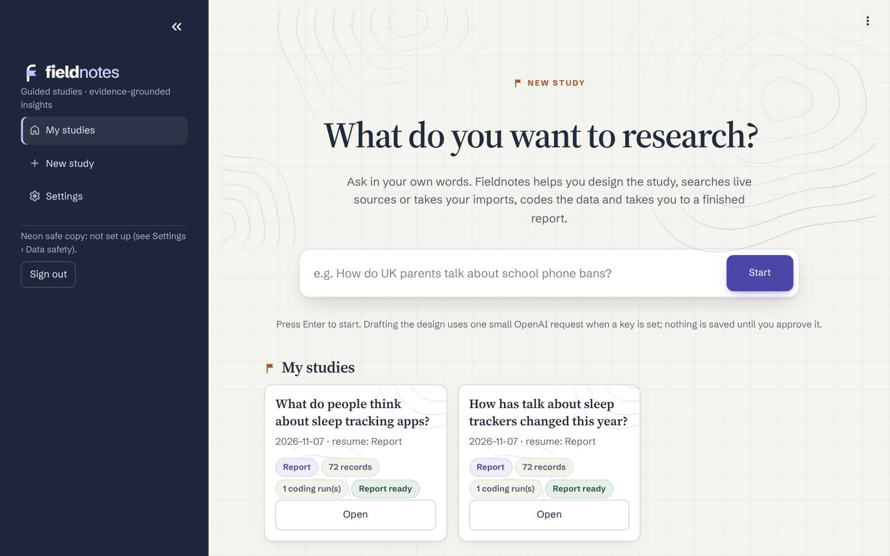

## What it does

| Step | What happens |
| --- | --- |
| **Design** | Type a rough question. AI drafts a research design: a precise question, the decision it informs, whose conversations count, the period, places and languages, and the kind of study. You check it and approve it. |
| **Refine** | AI suggests sharper research questions and search terms within the design; you approve them. |
| **Sources** | Search YouTube, Bluesky and the web, collect from RSS and Atom feeds, Hacker News and Stack Exchange, or import exports from listening tools such as Brandwatch, Talkwalker, Meltwater and Sprout Social. |
| **Overview** | A free first look: volume over time, platforms, most-used words, example posts, and whether the data fits your design. |
| **Codebook** | AI drafts a codebook (themes, sentiment, relevance) that follows the design; you check and approve it. |
| **Code** | Every post is coded by AI against the approved codebook, with a cost estimate first and live progress. |
| **Review** | Check the posts the AI was unsure about, plus a spot check, one at a time. |
| **Report** | A research summary with findings, what it means for your decision, audience needs and content ideas, downloadable as Word, PDF or Markdown. |

## What makes Fieldnotes different

**Fieldnotes puts a qualitative research method into an app.** It turns a question into a study you can defend:
a design, a codebook, coding of every post, human checks and agreement scores. Every figure is counted by
software, not written by AI, and every quotation is word-for-word and traceable to its post. It does this without
an enterprise data licence, by working from official APIs, public feeds and exports you're already entitled to.

### Compared with pasting posts into a general AI assistant

- **Numbers you can trust.** The app counts every figure from the coded data. The AI only writes prose, and any
  figure it states that the data doesn't support is flagged.
- **Real quotations.** Every quote is checked word-for-word against its post, keeps its platform and date, and
  links to the original wherever the source provides a link.
- **The same rules for every post.** Coding follows an approved, versioned codebook, not a fresh prompt each time.
  Each answer is checked against that codebook's structure before it's accepted. An invalid answer gets one repair
  attempt, and if it still fails, the post is reported as failed, never quietly dropped.
- **Repeatable.** Each coding run is pinned to the exact dataset and codebook version it used, so results can be
  traced and rerun.
- **People stay in charge.** Posts the AI was unsure about, plus a random spot check, go to a person. Every
  decision is kept as an audit trail, and the AI's original answer is never overwritten.
- **Measured reliability.** Fieldnotes can compare the AI against a hand-coded reference set (precision, recall
  and F1), and compare human coders with each other (Cohen's kappa for two, Fleiss' kappa for three to ten).
- **A research design first.** The question, population, period, places, languages and kind of study are agreed
  before any data is collected. Searching, coding and the report all follow the design, and every later step
  warns you if it changes.
- **Honest about limits.** Reports state what the sample is and isn't, what each source can and can't filter,
  and how much was checked by a person.
- **Costs and consent up front.** You see a cost estimate before coding starts, and nothing is sent to an AI
  service until you allow it.
- **It keeps watching.** Scheduled checks add only new posts, code them with the same codebook and show what
  changed.

### Compared with tools that need a special data licence

- **No enterprise licence or data reseller.** Sources are:
  - the official YouTube Data API;
  - Bluesky's public API;
  - Brave Search;
  - public RSS and Atom feeds;
  - Hacker News and Stack Exchange;
  - your own exports from listening tools.
- **No scraping, and no data you aren't entitled to.** Reddit is reached only through search-result snippets,
  and public-feed collection is planned and approved before it runs.
- **Built for analysis, not just dashboards.** You get codebooks, human review, agreement statistics, themes with
  the evidence for and against them, and a framework matrix, alongside volume, platform and word charts.
- **Your data stays yours.** It lives in your own database with a compressed safe copy and downloadable
  backups. Reports shared with other tools remove personal details from quotations.

What it doesn't claim: posts are a sample of public conversation, not a representative survey. Fieldnotes says
so in every report.

## Start with a research design

Fieldnotes turns a rough question into a study you can defend. It marks what it assumed so you can check it,
asks a few quick questions to sharpen the draft, and saves your work as you go. Choose from four kinds of
study: **exploratory**, **descriptive**, **comparative** (two or more groups, side by side) and
**longitudinal** (change over time). Research templates and advanced designs are there when you need them.
Searching, coding and the report all follow the approved design, and if the design changes after coding,
every later step says so.

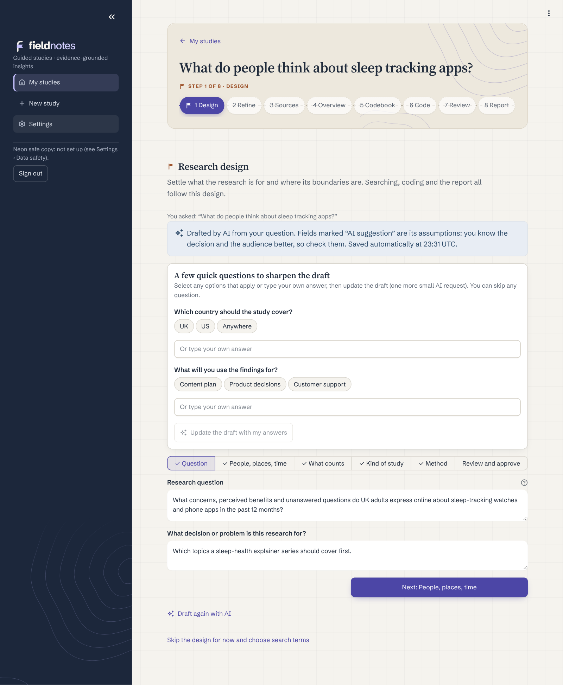

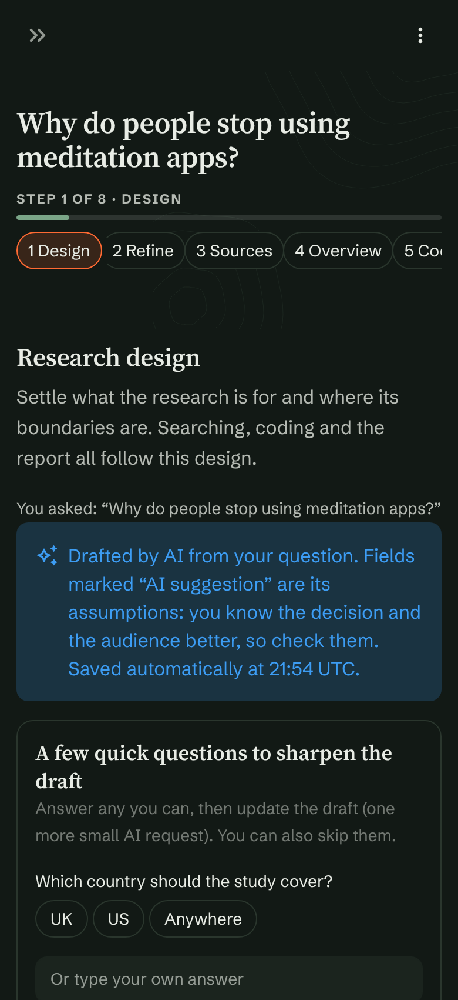

## More places to listen

Alongside YouTube, Bluesky and web search, Fieldnotes can collect from public RSS and Atom feeds, Hacker
News and Stack Exchange. It suggests feeds that match your research question. Every collection is planned
and approved first, and each source states exactly what it can and can't filter, so nothing is implied that
didn't happen.

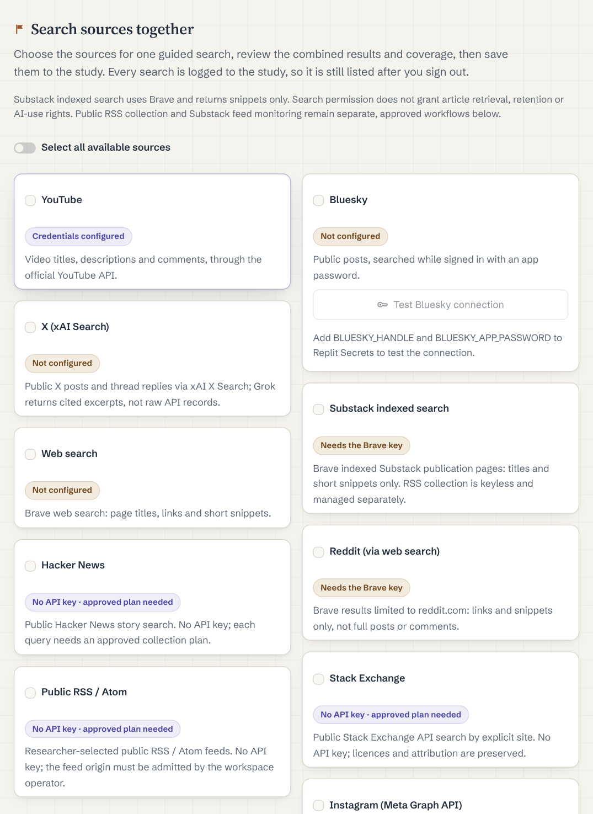

## See the data before you spend anything

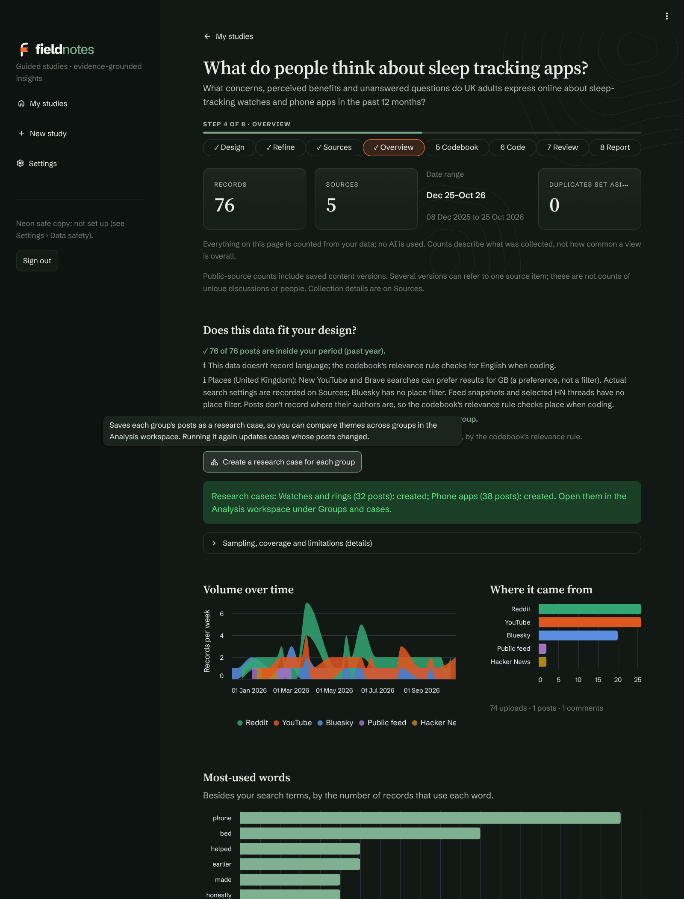

## A research summary you can trust

The app calculates every figure and picks every quotation from the coded data itself. The AI writes only
the prose: the headline, findings, what this means for your decision, what the audience wants to know and
what content to make. Any figure the AI states that the data doesn't back up is flagged.

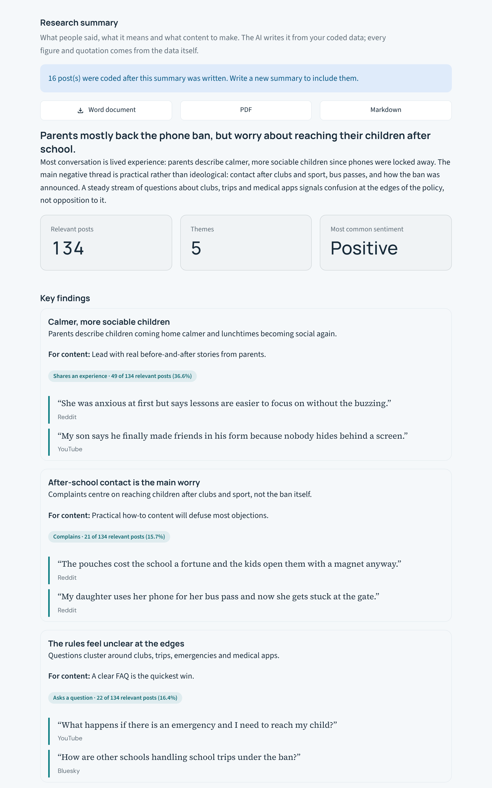

Comparative studies show each group side by side, including posts that belong to more than one group.

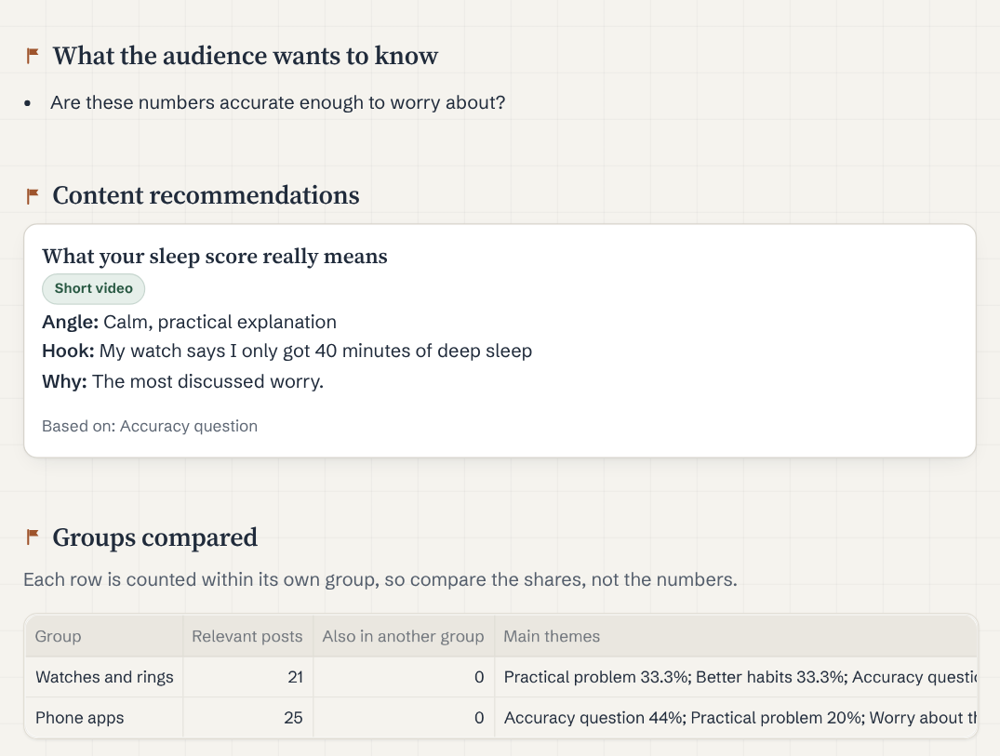

Longitudinal studies chart how often each theme comes up, month by month.

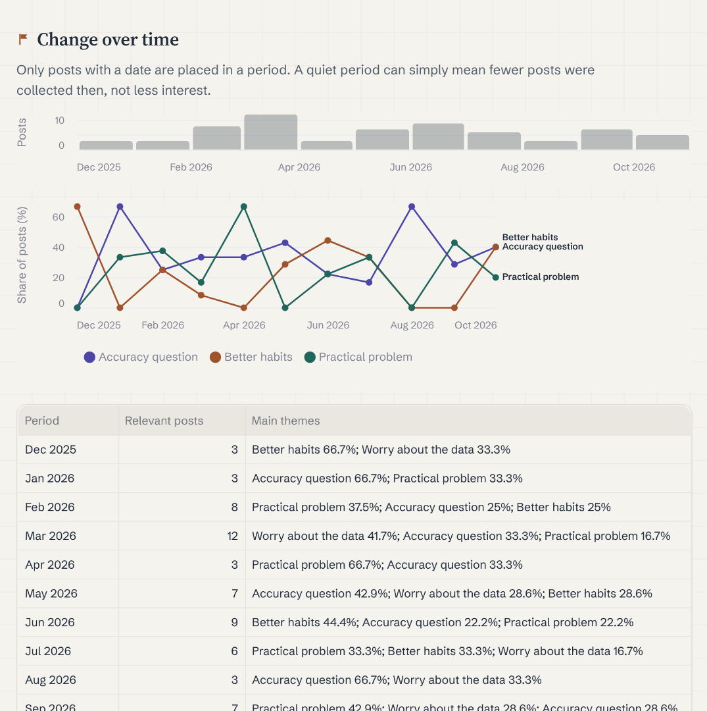

## Keeps watching the question

Turn on watching and Fieldnotes checks your sources on a schedule. Each check saves only posts that are
new to the study, codes them with the approved codebook, and shows what changed. Nothing runs, and nothing
is spent, until you allow it.

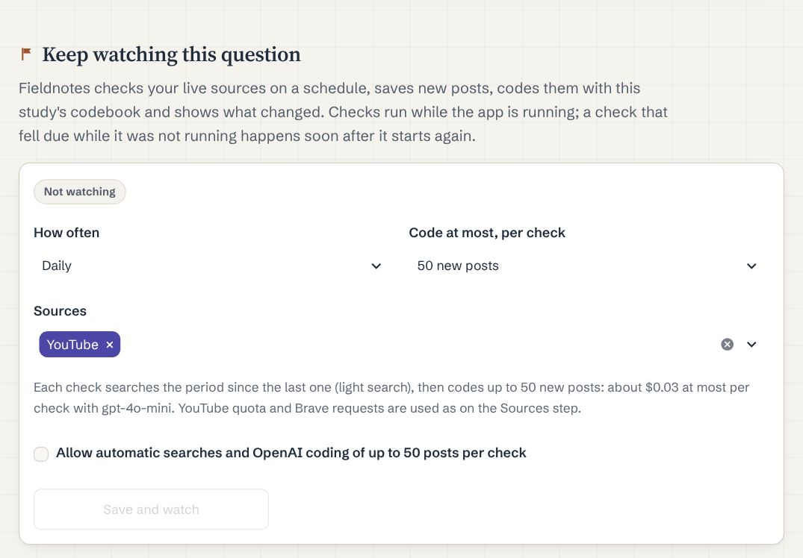

## People stay in charge

The AI's codes are checked where it was unsure, and every check is recorded. The report says exactly how
much was reviewed by a person.

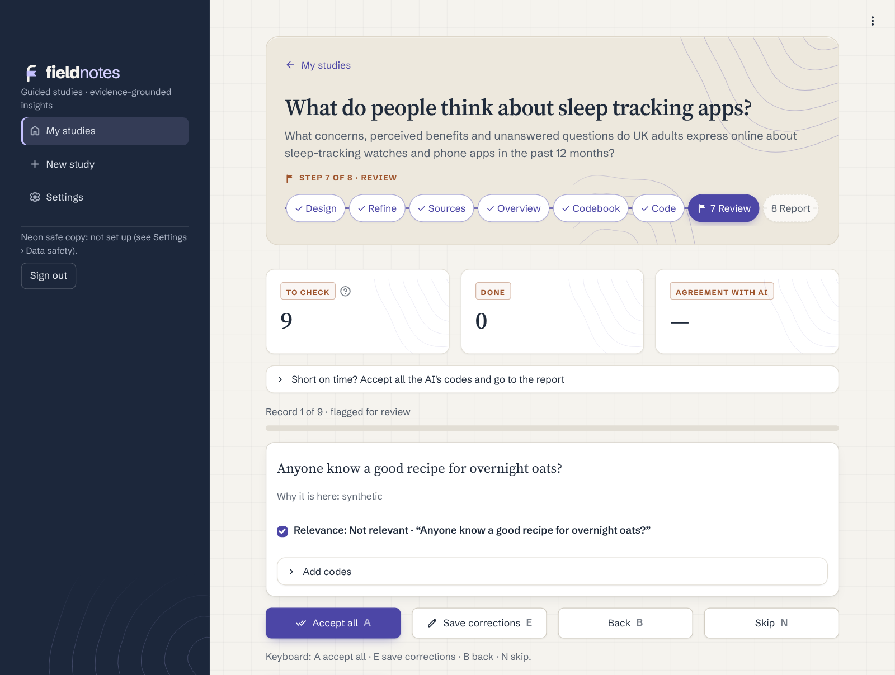

## Codebooks and coding

A codebook is the rulebook for coding: which themes exist, what each one means, and how a post qualifies.
Fieldnotes treats it as a research instrument. It's versioned and approved before use, and every coding run
records exactly which version it followed.

### How a codebook is structured

| Part | What it holds |
| --- | --- |
| **Dimensions** | The questions asked of every post, such as *Is it relevant?*, *What's the sentiment?* or *What topics does it raise?* Each is either single-choice or multiple-choice, can be required or optional, and can demand a supporting quotation from the post for every code chosen. |
| **Codes** | The possible answers. Each has a label, a definition, inclusion and exclusion criteria, worked examples, and a flag that sends uncertain cases to a person. Codes can be nested under parent codes, carry a researcher's memo and have a display colour. |
| **Relevance gate** | One dimension decides whether a post counts at all: relevant, not relevant or unclear. Every gate code must be classified, and unclear posts go to a person. Only relevant posts feed the figures. |
| **Analysis roles** | Which dimension holds sentiment, for example, so the charts use it. Roles are declared, never guessed from names. |
| **Guidance and examples** | Instructions the coder must follow, such as "do not infer age or gender", and up to 20 fully coded example posts. |
| **Signals and review triggers** | Yes/no flags the coder must report, such as "shares private information", and rules that send matching posts to human review. |

Codebooks follow a published, versioned format (schema 1.0 and 1.1) with a downloadable JSON Schema. They can
be imported and exported as JSON, so a framework can be reused across studies.

### How a codebook is generated

- **Drafted from your study.** AI reads your research questions, your approved research design and up to 50 of
  the study's own posts, then proposes topics inside a fixed, always-valid structure:
  - a relevance gate written from the design's population and inclusion rules;
  - a sentiment dimension;
  - one to three topic dimensions, each requiring a supporting quotation.
- **Works without AI too.** Without an AI key, a sound starter codebook is used instead, and you can edit it.
- **Nothing is used until you approve it.** Drafts are stored inactive. Editing a code's label, definition,
  criteria, examples, parent, memo or colour creates a new version, and the approved original never changes.
- **Restructure safely.** Merge or split codes into a new version. Earlier versions, their coding, reviews and
  reports stay exactly as they were.

### How posts are coded and checked

1. **Cost first.** You see an estimate and confirm before any post is sent to the AI.
2. **Structured answers.** Each post is coded against the approved codebook, with a supporting quotation wherever
   the codebook requires one, a confidence rating and the declared signals. Answers that break the codebook's structure are repaired once or
   reported as failed.
3. **Review routing.** Low-confidence answers, unclear relevance, possible sarcasm and any review trigger send a
   post to a person, together with a random spot check.
4. **Human review.** You accept, correct or add codes one post at a time. Each decision is a new record, the AI's
   original is kept, and reports use the human-reviewed version wherever it exists.
5. **Reliability, when you need it:**
   - compare the AI with a locked, hand-coded reference set (precision, recall, F1 and relevance accuracy);
   - give the same posts to two to ten coders and measure agreement (Cohen's or Fleiss' kappa).
6. **Deeper analysis.** In the analysis workspace you can:
   - code exact passages, with AI passage suggestions you can accept or reject;
   - see which themes tend to appear together;
   - build themes with the evidence for and against them;
   - use a framework matrix that summarises each code's evidence.

## Tools for detailed analysis

For deeper qualitative work, an optional analysis workspace adds passage coding, themes with the evidence
for and against them, a framework matrix, a hypotheses notebook, research cases and team coding with
agreement scores. Each keeps its own review steps and audit trail.

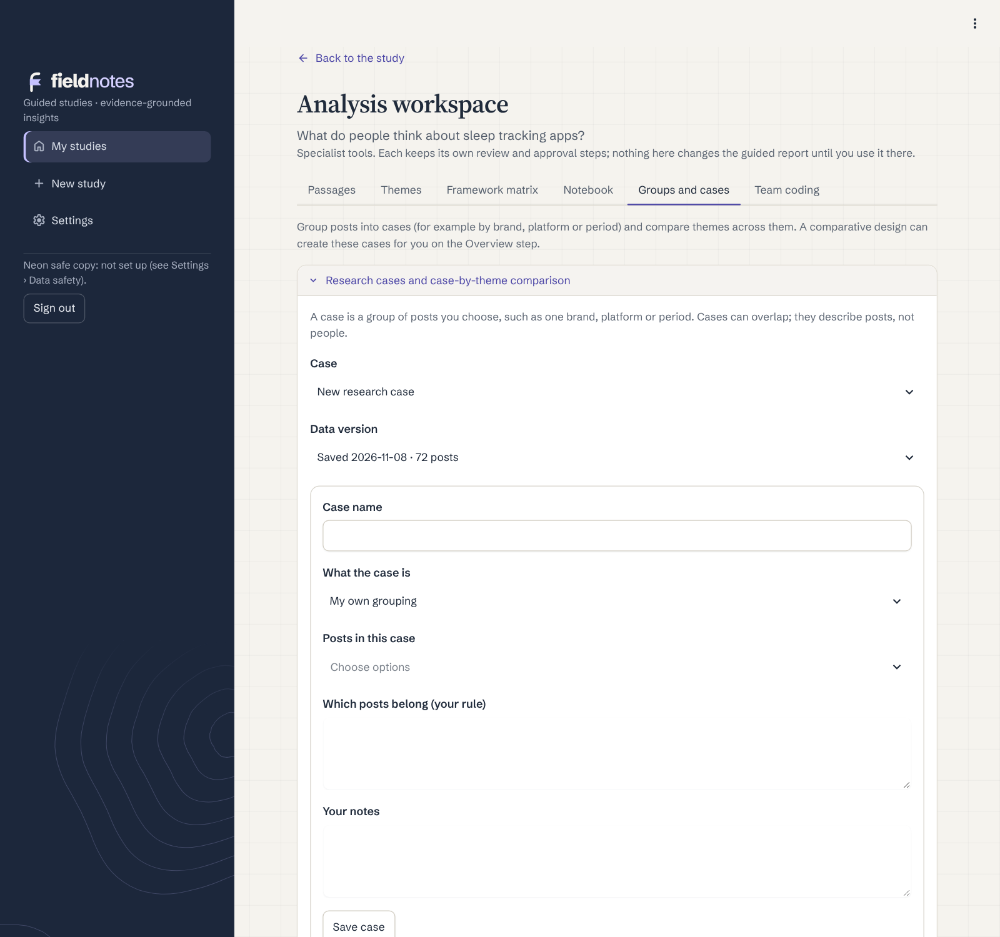

## Settings and advanced tools

Fieldnotes starts in a simple guided view: eight steps, one study at a time, nothing to configure. Everything
more specialised sits behind a switch in **Settings**, off until you turn it on, so a first-time user never sees
it and an experienced researcher can have all of it. Settings are saved in the research database, so they travel
with backups and the safe copy. In the demo they're shown but locked.

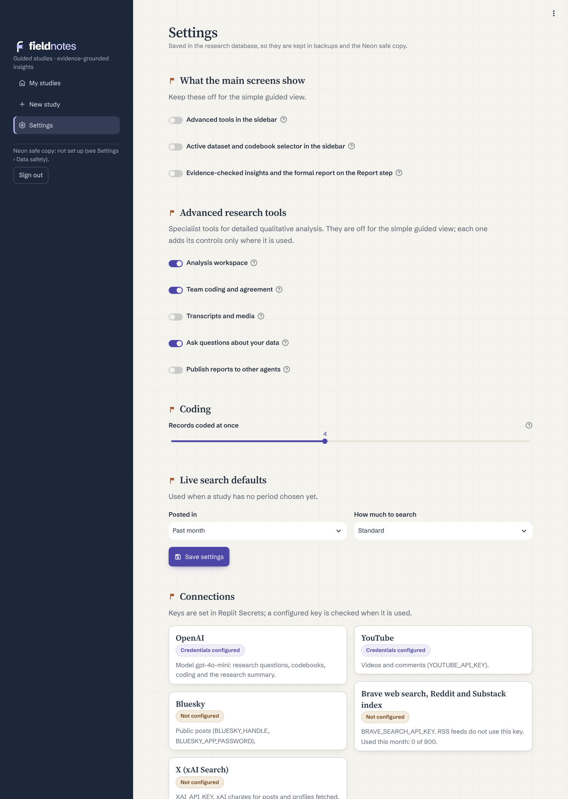

### What the main screens show

| Switch | What it does | Why it's there |
| --- | --- | --- |
| **Advanced tools in the sidebar** | Adds the full research workbench: project overview, research planning, collection, analysis handoff, uploads, data quality, codebooks, coding, gold sets, evaluation, human review, trends, insights, reports and backups. | The guided steps cover a typical study. The workbench is for work they don't cover, such as checking AI coding against a hand-coded gold set, editing a codebook in detail or inspecting data quality. |
| **Active dataset and codebook selector** | Shows which dataset and codebook the workbench pages are using, and lets you switch. | Guided studies choose these automatically. They only matter when you use the workbench directly. |
| **Evidence-checked insights and the formal report** | On the Report step, builds an evidence packet and asks the AI for candidate insights. Each must pass strict reference checks against the coded data, and the approved ones become a formal report. | For when a summary isn't enough and every claim needs an audit trail. The everyday research summary doesn't need it. |

### Advanced research tools

Each tool adds its controls only where they're used.

| Switch | What it does | Why it's there |
| --- | --- | --- |
| **Analysis workspace** | Opens a separate workspace from Overview and Report. It holds:<ul><li>passage coding (marking the exact words that show a code);</li><li>themes, with the evidence for and against them;</li><li>a framework matrix;</li><li>a hypotheses notebook;</li><li>research cases, for comparing themes across groups.</li></ul> | Detailed qualitative analysis that goes beyond coding whole posts. |
| **Team coding and agreement** | Gives several people the same posts to code separately, then shows how often they agree. | Checks that a codebook means the same thing to different coders before its results are trusted. |
| **Transcripts and media** | Adds subtitle files (.vtt, .srt) and local images, audio and video to the Sources step. | Some conversations happen in videos and podcasts, not posts. |
| **Ask questions about your data** | On the Report step, searches the study's coded evidence. Optional AI answers quote the exact passages they rely on, and each AI request is confirmed first. | Quick follow-up questions without rerunning the analysis. |
| **Publish reports for VELA** | On the Report step, checks a finished report and publishes it to a private reports repository, where a video-planning agent turns it into content ideas. The checks confirm:<ul><li>every figure comes from the data;</li><li>quotations are redacted;</li><li>nothing personal is left.</li></ul>Each report is published only after you read the quotations and approve it, unless you switch on automatic updates. | Lets research feed content planning directly, with the evidence attached. |

### Coding, search and connections

| Setting | What it does | Why it's there |
| --- | --- | --- |
| **Records coded at once** | How many posts the AI codes in parallel, from 1 to 8. | More is faster. Lower it if OpenAI reports rate limits for your account. |
| **Posted in** | The default period for live searches: past week, month, 3 months, year, or any time. | Used when a study's design hasn't set a period yet. |
| **How much to search** | Light, Standard or Deep. Standard is up to 10 videos with 20 comments each, 100 Bluesky posts and one page of web results. Deep is 25 videos, 50 comments, 200 posts and two pages. | Balances coverage against API quota and cost. |
| **Connections** | Shows whether OpenAI, YouTube, Bluesky and Brave Search are set up, plus Brave's monthly usage against its cap. Keys are never shown. | So you know which sources a search can use before you run it. |
| **Data safety** | Shows whether the compressed safe copy in Neon Postgres is on and up to date, and links to backups, copies and restore. | Research data is the one thing that can't be recreated, so its protection is always visible. |

## Works on a phone

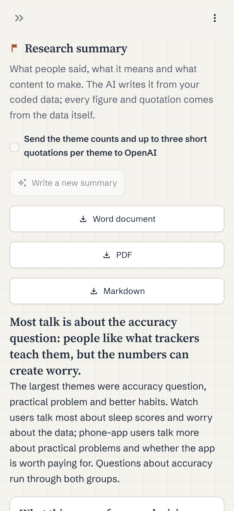

## Built with

Python and Streamlit. Coding and summaries use OpenAI, with strict structured outputs checked against
the codebook. Sources come from the YouTube Data API, Bluesky, Brave Search, public RSS and Atom feeds,
Hacker News and Stack Exchange. Data is stored in SQLite, with a compressed safe copy in Neon Postgres.
Finished reports can also be published, after you approve them, in a structured format that other tools
can read. Fieldnotes runs on Replit; the demo runs on Streamlit Community Cloud.

## About this repository

This repository only showcases Fieldnotes. It contains no source code, and the screenshots show
made-up example data. © 2026 camillaspica. All rights reserved.
